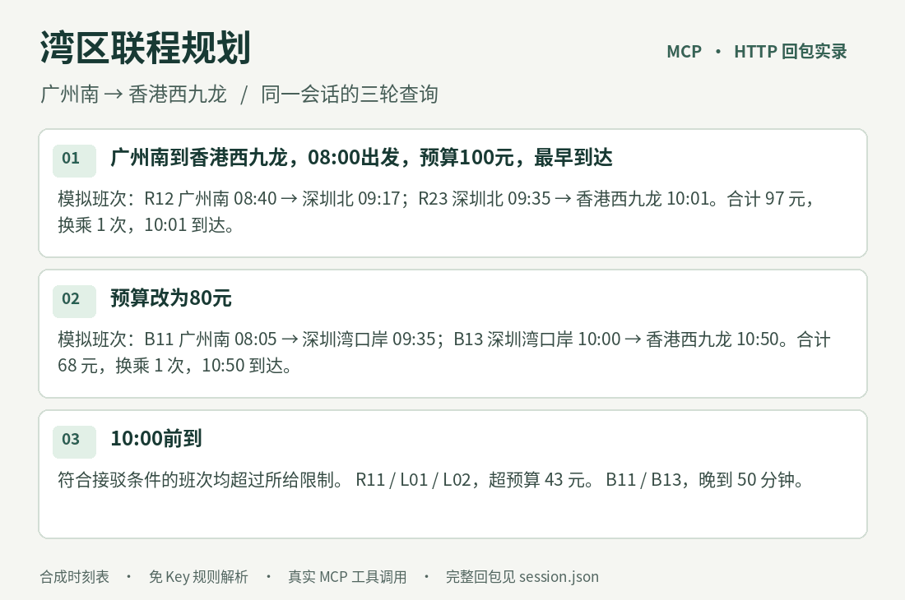
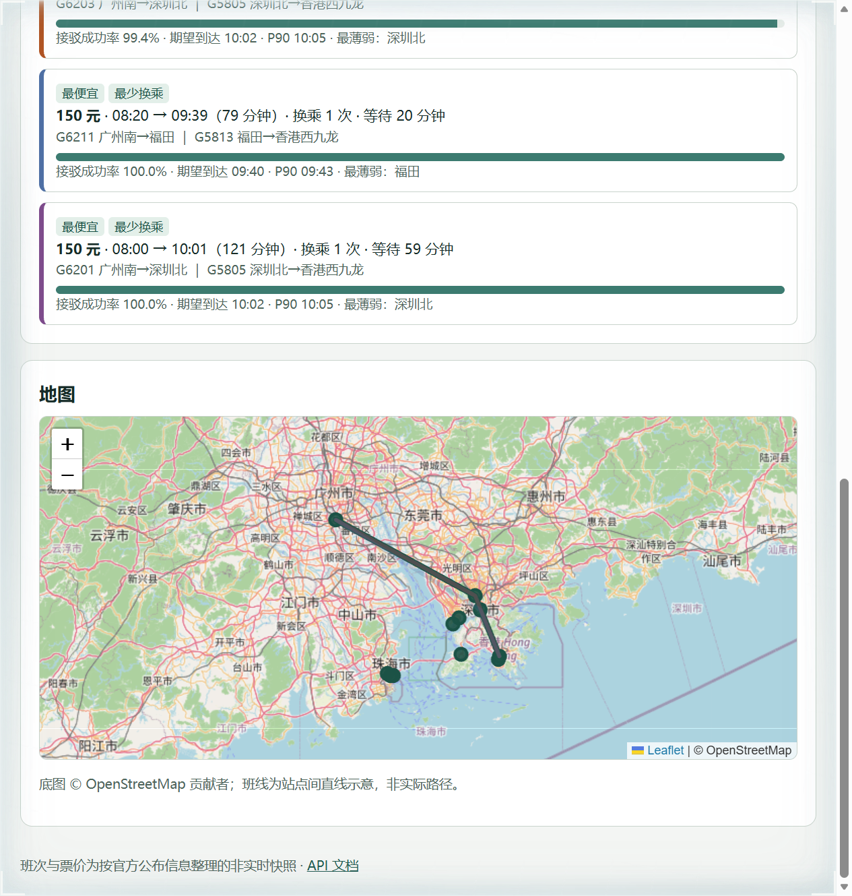

# 湾区跨境联程 Agent（bay-transit-agent）

把大创“大模型增强的跨境联程路径优化”设计落地成**可运行、可演示、可验证**的工程原型：自然语言提问 → MCP 工具查询真实口径班次快照 → Pareto 多目标选路（默认 4 个差异化方案）→ 蒙特卡洛接驳可靠性仿真 → 地图可视化。




## 与大创算法设计的对应关系

| 大创“研究二”设计 | 本工程原型的落地 | 说明 |
| --- | --- | --- |
| LLM 意图解析：偏好 → 权重 w，限制 → 硬约束 | `weight_time / weight_cost / weight_wait` + `max_fare / arrive_by / max_transfers` | 真实 LLM 模式下由模型直接填权重字段；免 Key 模式走规则解析 |
| 加权成本 J = w₁·Time + w₂·Cost + w₃·Trans | `score = w_t·总时长 + w_c·总费用 + w_w·中转等待` | 中转等待单独成维，对齐可研报告四个偏好维度 |
| 累计惩罚：超预算/延误才罚 | 硬约束过滤 + 无解时输出**可验证差额**（超预算 X 元 / 晚到 Y 分钟） | 超限路线不会被推荐成可行 |
| 生成式候选 + 多样性 | **Pareto 前沿**（时间/费用/换乘/等待四维）+ 默认 4 个差异化方案 | 对齐可研“至少 4 个个性化方案”验收口径 |
| 动态调整 / 实时性 | 蒙特卡洛延误仿真给出**接驳成功率、期望/P90 到达、最薄弱换乘** | 固定随机种子，结果可复现 |

**诚实边界**：GNN 客流建模、PPO 训练属于大创后续研究计划；本原型面向实时问答场景，用毫秒级、可解释、零训练依赖的“有界枚举 + Pareto + 加权标量化”实现同样的多目标语义。不宣称全局最优，不补造实测数字。

## 快速开始

```bash
pip install -r requirements.txt
python -m transit.web        # 打开 http://127.0.0.1:8001
python -m unittest discover -s tests   # 31 项验收（规划/仿真/HTTP/MCP 全链路）
```

- **免 Key 演示**：默认规则解析，输入“广州南到香港西九龙，08:00出发，预算160元，最早到达”，再追问“预算改为140元”看无解差额解释。
- **真实模型**：复制 `.env.example` 为 `.env` 填入任意 OpenAI 兼容 Key，多轮对话、权重解析与仿真工具调用由 LLM 完成。
- **演示页**：左侧多轮对话；右侧结构化查询 + 延误强度滑块（0–3×）+ 方案卡片 + OpenStreetMap 地图，拖滑块可直接观察接驳成功率变化。

## 演示脚本（面试用）

1. `广州南 → 香港西九龙，预算 160 元`：推荐经深圳北 150 元 09:19 到（Pareto：最快+最便宜），同时给出等待更少的备选。
2. `预算改为 140 元`：无解，返回**可验证差额**——最接近方案超预算 10 元；放宽到 150 即可。
3. 右侧滑块拖到 2.0×：各方案接驳成功率下降幅度不同，稳健性排序当场变化。
4. `广州南 → 澳门，预算 100 元`：广珠城际 + 拱北口岸步行，70 元。

## 数据与口径

`transit/fixtures/`：11 站（广州/深圳/香港/珠海/澳门）、67 条班次，覆盖高铁、城际、港珠澳大桥穿梭巴士（金巴）、跨境巴士、客船、口岸接驳，按官方公布时刻票价整理的非实时快照，来源与折算口径见 [fixtures/DATA.md](transit/fixtures/DATA.md)。站点含经纬度，供地图展示。`TRANSIT_DATA_DIR` 可指向自己的数据目录做 A/B 对比。

## 架构

```
transit/planner.py    有界路径枚举 + 硬约束 + Pareto 前沿 + 加权标量化 + 无解差额解释
transit/simulate.py   蒙特卡洛接驳可靠性仿真（方式相关延误分布 × 全局强度）
transit/server.py     MCP 服务：list_transit_stations / plan_transit / simulate_transit_route
transit/chat.py       规则解析（免 Key）+ 真实 LLM 系统提示
transit/web.py        FastAPI：/ /plan /simulate /stations /chat /health
host/                 Agent 宿主：MCP 连接管理、多步工具循环、SQLite 会话记忆、调用日志
tests/                31 项验收：规划语义、Pareto/权重、仿真统计、HTTP 与真实 MCP 子进程
```

## 背景与声明

本项目是广东工业大学省级大创“粤港澳大湾区跨境联程交通优化”研究二方向的**工程化延伸**（作者为大创学生负责人），面向 Agent 应用开发 / AI 解决方案实习岗位的作品集。原型开发使用 AI 辅助，全部验收测试与仿真数字来自本仓库可复现的代码与数据。
