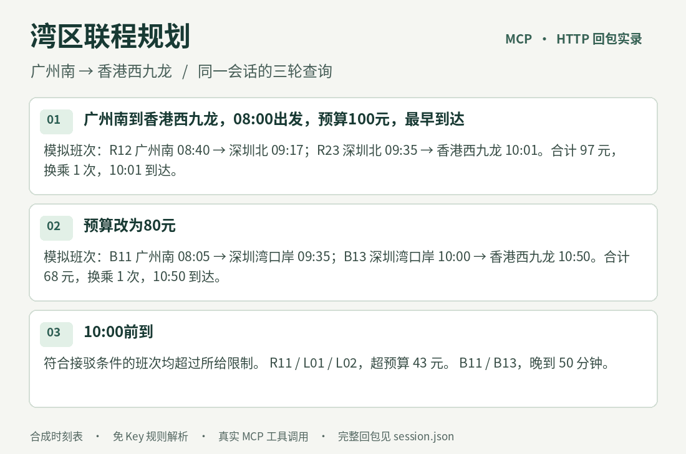

# 湾区跨境联程规划 Agent

旅客从广州南去香港西九龙，先说“预算 100 元，想尽早到”，随后把预算改为 80 元，最后要求上午 10 点前到。这个原型沿用同一会话的起终点，从合成时刻表中找出能接上的班次，并在无解时给出可核查的差额。



[查看三轮请求、工具参数和完整响应](examples/session.json) · [查看 21 项自动化验收](../tests/test_transit.py) · [查看合成班次](fixtures/services.csv)

## 三个可以当场验证的问题

| 广州南 → 香港西九龙，08:00 后出发 | 本地运行结果 | 验收依据 |
| --- | --- | --- |
| 预算 100 元，希望最早到达 | R12 → R23，97 元，10:01 到 | 深圳北接驳 18 分钟，满足该站 12 分钟下限 |
| 同一会话把预算改为 80 元 | B11 → B13，68 元，10:50 到 | 深圳湾口岸接驳 25 分钟，满足 20 分钟下限 |
| 再要求 10:00 前到 | 无可行路线 | 守住预算的 B11 → B13 晚 50 分钟。能准时到的 R11 → L01 → L02 超预算 43 元 |

“便宜一点”表示按总价排序，“最多 100 元”会排除超预算路线。广州南到深圳北的 R11 即使能在 R21 发车前到站，两车之间也只剩 6 分钟，系统会剔除这一组合。输入“深圳到香港西九龙”会给出三个候选出发站，下一轮可直接回复“深圳北”。

## 在本机运行

在本仓库根目录打开终端。使用 Python 3.11 或 3.12。Windows 可以直接[下载仓库 ZIP](https://github.com/maokong-nb/bay-transit-agent/archive/refs/heads/main.zip)，先解压，再进入能看见 `requirements.txt` 的文件夹。PowerShell 中运行以下命令即可。免 Key 模式无需创建 `.env`。

```powershell
py -3 -m venv .venv
.\.venv\Scripts\python.exe -m pip install -r requirements.txt
$env:MOCK_LLM = "1"
.\.venv\Scripts\python.exe -m transit.web
```

macOS 或 Linux 可从仓库根目录运行：

```bash
python3 -m venv .venv
.venv/bin/python -m pip install -r requirements.txt
MOCK_LLM=1 .venv/bin/python -m transit.web
```

打开 [本地演示页](http://127.0.0.1:8001/)，提交页面预填行程，再用“改为 80 元”填入追问并查询。[本地 API 文档](http://127.0.0.1:8001/docs) 可直接提交结构化请求。切换真实模型时，在本地配置 `LLM_API_KEY`、`LLM_BASE_URL` 和支持工具调用的 `LLM_MODEL`，清除 `MOCK_LLM` 并重启。模型请求和工具返回可能计费，实际表现待单独评测。

## 从需求到代码

| 业务问题 | 实现位置 | 行为 |
| --- | --- | --- |
| 自然语言里同时含有硬约束和偏好 | [会话与工具调用](chat.py) | 有 Key 时可选择兼容的模型；离线演示使用明确的中文语法。两种入口共用 MCP 工具协议 |
| 推荐的两趟车是否接得上 | [班次搜索](planner.py) | 按出发时刻、每站接驳下限枚举最多三段的同日路线，剔除环路；校验总预算、最迟到站和换乘上限，再按偏好排序 |
| 服务如何被上层发现 | [MCP Server](server.py) / [可配置宿主](../host/agent.py) | stdio 独立进程提供 `list_transit_stations` 与 `plan_transit`。宿主提供 SQLite 会话记忆和 JSONL 工具日志 |
| 业务系统怎样接入 | [HTTP 接口](web.py) | `POST /plan` 输入结构化参数；`POST /chat` 输入自然语言；`GET /health` 查看当前模式与发现的工具 |
| 如何复现验收 | [验收代码](../tests/test_transit.py) | 13 项检查班次、边界、导入和失败解释；8 项经 FastAPI 检查 API、真实 MCP 子进程、跨轮追问及会话隔离 |

在激活项目虚拟环境后，从根目录运行：

```bash
python -m unittest discover -s tests -p test_transit.py -v
```

本次在 Python 3.12 上运行，21 项通过。对话验收使用规则解析器，运行记录中的模型 token 为 0。兄弟项目 [MCP 多服务智能助手](https://github.com/maokong-nb/mcp-multi-service-assistant) 的 24 题评测覆盖日期、天气和笔记服务，是另一组用例。

## 替换班次数据

将 [stations.csv](fixtures/stations.csv) 和 [services.csv](fixtures/services.csv) 复制到同一目录，保留表头。设置 `TRANSIT_DATA_DIR` 为该目录后重启服务，HTTP 与 MCP 均读取这份数据。

| 文件 | 必填列 | 约定 |
| --- | --- | --- |
| stations.csv | id, name, city, min_transfer_min | 唯一站点 ID、站名、城市、本站最少换乘分钟数 |
| services.csv | id, origin, destination, depart, arrive, fare_cny, mode | 唯一班次 ID、两个站点 ID、同日 24 小时时刻、非负整数人民币票价、交通方式 |

本例覆盖 5 个站点、12 条自建合成班次。数据不代表运营商实际线路、班次、票价或通关时间。程序只提供本地同日选路；跨日时刻、动态余票、购票及线上客运系统接入均需另行实现。多实例部署时还需引入适配的会话并发机制。

## 项目来源

从跨境联程大创的意图与约束设计出发，在自建的 [MCP 多服务智能助手](https://github.com/maokong-nb/mcp-multi-service-assistant) 宿主上以 AI 辅助开发完成此公开原型。这里实现的算法是小规模有界路径枚举。查阅的开源资料为 [MCP Python SDK](https://github.com/modelcontextprotocol/python-sdk) 和 [OpenTripPlanner](https://github.com/opentripplanner/OpenTripPlanner)。前者用于服务发现与调用，后者可对照了解大型多模式行程规划系统的范围。
